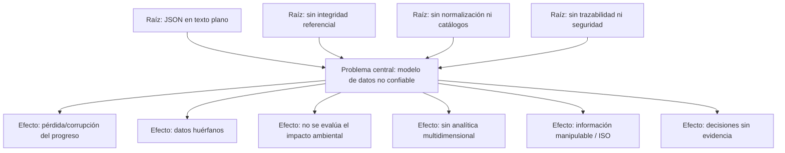

# Árbol de Problemas — Modelo de Base de Datos

**Proyecto:** Videojuego con Inteligencia Artificial para Educación Ambiental
**Documento base:** `Modelo_Base_de_Datos.md`
**Archivo visual:** `arbol_de_problemas_bd.html`
**Técnica:** Árbol de problemas (causas → problema central → efectos)

---

## ¿Qué es un árbol de problemas?

Es una herramienta de diagnóstico que ordena la información en tres niveles:

- **Las Raíces (causas):** el origen del problema, lo que lo provoca.
- **El Tronco (problema central):** la situación negativa que se quiere resolver.
- **Las Hojas y Ramas (efectos):** las consecuencias visibles del problema.

---

## 1. Raíces — Causas subyacentes

1. **Persistencia en texto plano.** El progreso se guardaba en archivos JSON (`jugadores.json`, `sesion.json`), manipulables a mano y sin transacciones.
2. **Sin integridad referencial.** No existen claves foráneas ni borrado en cascada entre las tablas, por lo que se generan datos huérfanos.
3. **Sin normalización ni catálogos.** Los datos descriptivos se repiten (redundancia) y son difíciles de consultar.
4. **Sin trazabilidad ni seguridad.** No hay un registro estructurado de las decisiones del jugador ni series temporales del entorno, y tampoco criterios de seguridad o respaldo (ISO 27001/27002).

---

## 2. Tronco — Problema central

> **El videojuego no cuenta con un modelo de datos confiable que garantice la integridad del progreso ni la medición del impacto ambiental del jugador.**

---

## 3. Copa — Efectos o consecuencias

Agrupados en tres ramas:

**Rama A — Integridad de datos**
- Pérdida o corrupción del progreso e ítems del jugador.
- Datos huérfanos e inconsistentes (perfiles, partidas, sesiones).

**Rama B — Medición y análisis**
- Imposible evaluar el impacto ambiental de las decisiones.
- Sin analítica multidimensional del aprendizaje (cubo / ROLAP).

**Rama C — Seguridad y trazabilidad**
- Información en texto plano manipulable (no cumple ISO 27001/27002).
- Decisiones de diseño sin historial ni evidencia que las sustente.

---

## 4. Solución — Modelo relacional embebido (SQLite 3)

El árbol de problemas se complementa con los pilares que resuelven cada causa:

| N.º | Pilar | Qué resuelve |
|---|---|---|
| 1 | **Motor SQLite 3 embebido y local** (sin servidor ni internet) | Persistencia transaccional en un archivo binario, no en texto plano. |
| 2 | **Integridad referencial** con `ON DELETE CASCADE` y `SET NULL` | Elimina datos huérfanos e inconsistentes. |
| 3 | **Normalización 1FN–3FN** (catálogos vs. tablas de hechos) | Quita la redundancia y facilita las consultas. |
| 4 | **Historial** (`registro_accion` e `indicador_ambiental`) | Registra decisiones y series temporales del entorno. |
| 5 | **Índices + cubo ROLAP y respaldo** (ISO 27001/27002) | Acelera consultas, permite el análisis multidimensional y protege los datos. |

---

## 5. Relación lógica (resumen)

---

## Uso en el documento

Este árbol sustenta el **Anexo / Capítulo III (Marco Práctico)** del documento
`Juego_ambiental_ia_reactiva-2.docx`, en la sección de **Modelo de Base de Datos**,
demostrando que el diseño relacional responde directamente a causas reales del
problema y no a una decisión meramente técnica.

> `arbol_de_problemas_bd.html` — versión visual lista para imprimir o exportar a PDF/PNG.
